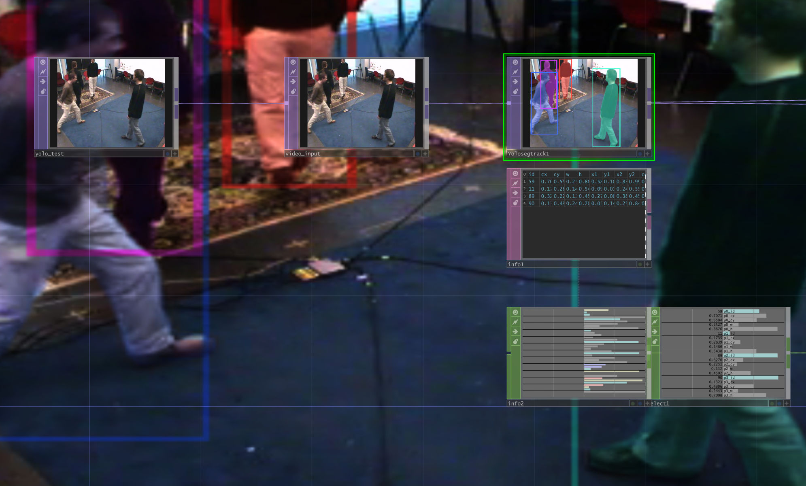

# yolo_top

People tracking and segmentation in TouchDesigner with YOLO26.

Runs on Windows (with or without an NVIDIA GPU) and on macOS.

[Español más abajo](#español)



## Contents

| Folder | What it is |
|---|---|
| [`example`](example) | `yolo_top_example.toe`: a ready-made network with a test video (`yolo_test.mp4`). |
| [`models`](models) | `yolo26n-seg.onnx`, a ready-to-use model. |
| [`native/YoloSegTOP`](native/YoloSegTOP/README.md) | Native operator. **YOLO Seg Track** detects, tracks and segments people. One plugin that picks its backend: **CUDA + TensorRT** on NVIDIA (~3-5 ms per frame), **ONNX Runtime** elsewhere (CoreML on Mac, DirectML or CPU on Windows). |

## Quick start

1. Download from [Releases](https://github.com/armdz/yolo_top/releases/latest):
   - `YoloSegTOP.dll` (Windows) or `YoloSegTOP-macOS.zip` (macOS).
   - `yolo26n-seg.onnx`: a ready-to-use model (YOLO26n-seg, 384×640). It is also in [`models/`](models).
2. Install the operator:

   | System | How |
   |---|---|
   | Windows | Copy `YoloSegTOP.dll` to `Documents\Derivative\Plugins` and restart TouchDesigner. Without NVIDIA, also run [`get_directml.bat`](native/YoloSegTOP/scripts/get_directml.bat) to use the GPU (AMD or Intel). |
   | macOS | Unzip `YoloSegTOP-macOS.zip`, copy `YoloSegTOP.plugin` to `~/Library/Application Support/Derivative/TouchDesigner099/Plugins` and restart TouchDesigner. If macOS blocks it, run `xattr -dr com.apple.quarantine` on the copied plugin. To build it yourself: `bash native/YoloSegTOP/build_mac.sh` (see [macOS](native/YoloSegTOP/README.md#macos)). |

3. In TouchDesigner: OP Create, **Custom** tab, **YOLO Seg Track**. Connect a camera and choose `yolo26n-seg.onnx` in *Model File*.
   - With NVIDIA, the first load builds the TensorRT engine: it takes several minutes (the operator shows a warning meanwhile) and is cached next to the `.onnx`, so later loads are instant.

## Example

Open [`example/yolo_top_example.toe`](example/yolo_top_example.toe) (with the operator installed). It plays `example/yolo_test.mp4` through a **YOLO Seg Track** that already points to `models/yolo26n-seg.onnx`, with an Info DAT and an Info CHOP showing each person's data. Keep the `example` and `models` folders together, as in the repo: the paths are relative.

To export other models (bigger, other aspect ratios), see [Models](native/YoloSegTOP/README.md#models). Details (parameters, outputs, building, troubleshooting) are in [`native/YoloSegTOP/README.md`](native/YoloSegTOP/README.md).

## Releases

Pushing a version tag publishes a release with the Windows DLL (`native/YoloSegTOP/build/YoloSegTOP.dll`, built with `build.bat` and committed), the macOS zip (`native/YoloSegTOP/build/YoloSegTOP-macOS.zip`, built with `build_mac.sh` and committed), the model and `get_directml.bat`:

```
git tag v1.0.1
git push origin v1.0.1
```

## Requirements

- TouchDesigner 2025 (the CUDA backend uses the TensorRT 10.9 DLLs that ship with TD 2025.33230).
- Windows 10/11 (fastest with an NVIDIA RTX 20 GPU or newer), or a Mac with macOS 13.4 (Ventura) or newer (required by ONNX Runtime).

## License

The YOLO26 model and the ByteTrack port are based on [Ultralytics](https://github.com/ultralytics/ultralytics) code, licensed under AGPL-3.0.

---

## Español

Tracking y segmentación de personas en TouchDesigner con YOLO26, como operador nativo. Anda en Windows (con o sin placa NVIDIA) y en Mac.

### Qué hace

**YOLO Seg Track** detecta a las personas en la imagen, le da a cada una un ID que se mantiene mientras sigue en cuadro (ByteTrack) y saca su máscara.

- **Con NVIDIA** (RTX 20 o más nueva) usa CUDA + TensorRT: unos 3-5 ms por frame.
- **Sin NVIDIA** usa ONNX Runtime: en Windows corre en la placa de video con DirectML o en CPU, y en Mac usa CoreML (GPU y Neural Engine). La red corre en un hilo aparte, así que TouchDesigner no se traba; la salida va 1 o 2 frames atrasada.

Es un solo plugin: elige el motor solo al arrancar TouchDesigner. Un `.toe` hecho en una máquina abre igual en cualquier otra.

### Instalación en Windows

1. Bajá de [Releases](https://github.com/armdz/yolo_top/releases/latest) el `YoloSegTOP.dll` y el modelo `yolo26n-seg.onnx` (el modelo también está en [`models/`](models)).
2. Copiá `YoloSegTOP.dll` a `Documents\Derivative\Plugins` (si la carpeta no existe, creala).
3. Si **no** tenés NVIDIA, corré [`get_directml.bat`](native/YoloSegTOP/scripts/get_directml.bat) para que use la placa de video (AMD o Intel). Sin eso anda igual, pero en CPU y más lento.
4. Reiniciá TouchDesigner.

### Instalación en Mac

Bajá de [Releases](https://github.com/armdz/yolo_top/releases/latest) el `YoloSegTOP-macOS.zip`, descomprimilo, copiá `YoloSegTOP.plugin` a `~/Library/Application Support/Derivative/TouchDesigner099/Plugins` y reiniciá TouchDesigner. Necesitás macOS 13.4 o más nuevo. El plugin no está notarizado: si macOS lo bloquea, corré:

```bash
xattr -dr com.apple.quarantine ~/Library/Application\ Support/Derivative/TouchDesigner099/Plugins/YoloSegTOP.plugin
```

Para compilarlo vos mismo necesitás las herramientas de Xcode y CMake:

```bash
xcode-select --install
brew install cmake
cd native/YoloSegTOP
bash build_mac.sh
```

El script baja ONNX Runtime, compila el plugin y lo instala en `~/Library/Application Support/Derivative/TouchDesigner099/Plugins`. El modelo `yolo26n-seg.onnx` lo bajás de [Releases](https://github.com/armdz/yolo_top/releases/latest) o lo tomás de [`models/`](models). La primera vez que TouchDesigner carga el plugin, te pide permiso.

### Ejemplo

Abrí [`example/yolo_top_example.toe`](example/yolo_top_example.toe) (con el operador instalado). Reproduce `example/yolo_test.mp4` a través de un **YOLO Seg Track** que ya apunta a `models/yolo26n-seg.onnx`, con un Info DAT y un Info CHOP que muestran los datos de cada persona. Dejá las carpetas `example` y `models` juntas, como están en el repo: las rutas son relativas.

### Uso

1. En TouchDesigner: OP Create, pestaña **Custom**, **YOLO Seg Track**.
2. Conectale la cámara o el video.
   - Con NVIDIA, la entrada tiene que ser **8 bit RGBA**. Si no lo es, poné *Pixel Format = 8-bit fixed (RGBA)* en el TOP anterior.
3. En *Model File* elegí `yolo26n-seg.onnx`.
   - Con NVIDIA, la primera vez arma el engine de TensorRT. Tarda varios minutos y mientras tanto el operador muestra un warning. Después lo guarda al lado del `.onnx` y las próximas veces carga al toque.
4. Elegí qué querés en *Task*:
   - *Segmentation + Tracking* (por defecto): máscaras e IDs que se mantienen.
   - *Segmentation*: solo máscaras. Los IDs se renumeran en cada frame (1, 2, 3… por confianza).
   - *Tracking*: solo posiciones e IDs, con cajas en lugar de máscaras. Es lo más rápido.

**Salidas:**

- **Imagen**, según *Output*: máscara blanca, un color por ID, u overlay con la imagen de entrada.
- **Info DAT** (conectale un Info DAT): una fila por persona con `id, cx, cy, w, h, x1, y1, x2, y2, conf, area`, normalizado de 0 a 1 y con y medida desde arriba.
- **Info CHOP**: cantidad de personas, tiempos y `p<i>_id`, `p<i>_cx`, `p<i>_cy`, `p<i>_w`, `p<i>_h` por persona.

El popup de info (clic del medio sobre el operador) te dice qué motor está usando.

### Si algo no anda

| Mensaje | Qué hacer |
|---|---|
| *The input must be 8-bit RGBA* | Poné *Pixel Format = 8-bit fixed (RGBA)* en el TOP anterior. |
| *Unexpected model format* | Usá un YOLO26 seg exportado a ONNX (ver [Models](native/YoloSegTOP/README.md#models)). Los YOLOv8/11 no sirven tal cual. |
| *onnxruntime.dll not found* | Usá TouchDesigner 2023 o más nuevo, o corré `get_directml.bat`. |
| Va lento | Mirá el motor en el popup de info. Si en Windows dice *ONNX Runtime CPU*, instalá DirectML o revisá el driver de NVIDIA. |

### Otros modelos

Para exportar un modelo más grande (más preciso y más lento) o para otra relación de aspecto, con Python y Ultralytics:

```python
from ultralytics import YOLO
YOLO("yolo26s-seg.pt").export(format="onnx", imgsz=(384, 640), half=False, simplify=True)
```

`imgsz=(384, 640)` es para 16:9. Para otra relación de aspecto usá la medida que corresponda, en múltiplos de 32.

### Releases

Si subís un tag de versión, GitHub publica el release solo, con la DLL de Windows (`native/YoloSegTOP/build/YoloSegTOP.dll`, la que compila `build.bat` y está en el repo), el zip de Mac (`native/YoloSegTOP/build/YoloSegTOP-macOS.zip`, lo arma `build_mac.sh` y está en el repo), el modelo y `get_directml.bat`:

```
git tag v1.0.1
git push origin v1.0.1
```
